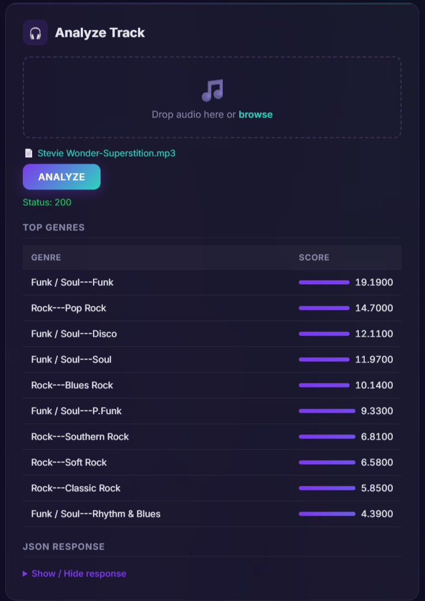
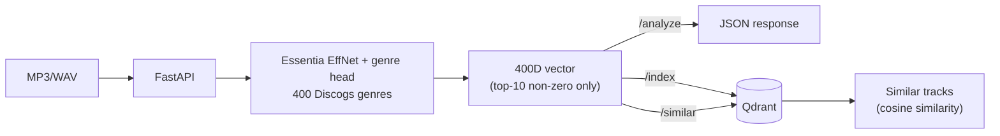
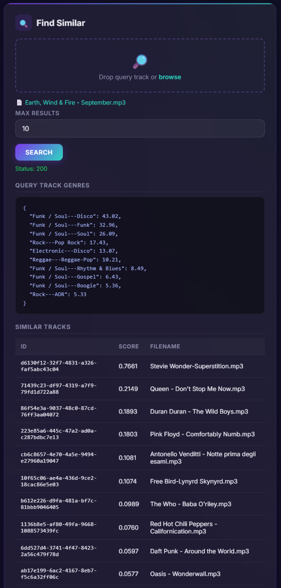

# SoundDNA

A music similarity search engine: from audio to a vector database, exposed via API and containerized.

> **Note:** This is version 1.0 (audio pipeline). A newer version with a natural-language chat layer is in development on the `dev` branch.


Upload an MP3/WAV track and the service will:

1. recognize its style across **400 genres** from the Discogs taxonomy;
2. transform it into a **vector** that describes its stylistic profile;
3. save it in **Qdrant** and find the **most similar tracks** in the catalog.

Originally developed as my Master's thesis project in Data Analytics.



---

## 🏗️ Architecture



**How it works:**

- **Audio analysis**: two pre-trained [Essentia](https://essentia.upf.edu/models.html) models. The first (EffNet) extracts embeddings from the signal, the second estimates the track's probability for each of the 400 genres.
- **Genre vector**: out of the 400 values, only the top 10 are kept; the rest are zeroed out. The vector remains interpretable (each dimension is a genre) and less noisy.
- **Search**: vectors are stored in Qdrant and compared using cosine similarity.
- **Interfaces**: REST API with Swagger, web dashboard, and command-line client.
- **Deploy**: Docker Compose (API + Qdrant). Works offline too, once the models are downloaded.

---

## 🧭 Design decisions

- **Pre-trained models instead of training from scratch**: Essentia's Discogs models are trained on millions of tracks, far beyond what a custom dataset could offer. The work is in integrating them reliably, not retraining them.
- **Top-10 sparse vector**: keeping only the strongest genres removes low-probability noise and keeps every dimension interpretable, which makes similarity results explainable.
- **Qdrant + cosine similarity**: purpose-built vector search with payload storage, easy to run locally and to scale later.
- **Offline-first Docker deployment**: once the models are downloaded, the whole stack runs without internet access, which suits environments with network or privacy constraints.

---

## 🎧 Example result

Given *September* (Earth, Wind & Fire) as query input (a track not present in the catalog), the top recommendation in the catalog is *Superstition* (Stevie Wonder) with a similarity score of **0.77**, while the second result drops to **0.21**, reflecting the clear funk/soul stylistic affinity.



The notebook [`EDA_qdrant.ipynb`](EDA_qdrant.ipynb) contains the exploratory analysis of the saved vectors, with PCA and t-SNE projections: tracks cluster by genre family (rock, electronic, jazz, classical).

---

## 🚀 Quick start

### 1. Download the models

Before building the Docker image, download the Essentia pre-trained models into the `models/` directory:

```bash
python download_models.py
```

*(Requires `requests`: `pip install requests`)*

### 2. Start with Docker Compose

```bash
docker compose up --build
```

Once running, the following services are available:

| Service      | URL                                      |
|---|---|
| Dashboard    | http://localhost:8000/static/index.html  |
| Swagger UI   | http://localhost:8000/docs               |
| Qdrant       | http://localhost:6333/dashboard          |

<details>
<summary>Run the API without Docker</summary>

```bash
pip install -r requirements.txt
docker run -p 6333:6333 qdrant/qdrant
uvicorn server:app --reload --port 8000
```

Note: `essentia-tensorflow` wheels are published for Linux only. On Windows and macOS, use Docker.
</details>

---

## 🔌 Endpoints

| Method | Endpoint            | Description                                                              |
|---|---|---|
| POST   | `/analyze`          | Returns the top-10 genres and the 400D vector, without saving anything   |
| POST   | `/index`            | Analyzes the track and saves it in Qdrant (`track_id` optional)          |
| POST   | `/similar?limit=10` | Returns the most similar already-indexed tracks                          |
| GET    | `/debug/{track_id}` | Shows what is stored in Qdrant for that track                            |

<details>
<summary>Example response from <code>/similar</code></summary>

```json
{
  "filename": "September.mp3",
  "similar_tracks": [
    {
      "id": "track_001",
      "score": 0.77,
      "filename": "Superstition.mp3",
      "top_genres": { "Funk / Soul---Funk": 34.2, "Funk / Soul---Soul": 28.1 }
    },
    {
      "id": "track_002",
      "score": 0.21,
      "filename": "Another Track.mp3",
      "top_genres": { "Rock---Hard Rock": 22.0 }
    }
  ]
}
```
</details>

### Command-line client

```bash
python client.py analyze song.mp3
python client.py index song.mp3
python client.py similar song.mp3
```

---

## 📂 Project structure

```
├── server.py            # FastAPI server (analyze, index, similar, debug)
├── client.py            # CLI client
├── download_models.py   # Downloads Essentia models into models/
├── static/index.html    # Web dashboard
├── EDA_qdrant.ipynb     # Exploratory analysis of the vectors
├── docs/                # Diagrams and screenshots
├── requirements.txt     # Python dependencies
├── Dockerfile
└── docker-compose.yml
```

---

## ⚠️ Limitations

- This is a prototype: tested on a catalog of ~20 tracks with qualitative evaluation only.
- Models are pre-trained and used as-is, without fine-tuning.
- The vector describes genre only. Tempo, mood, and instrumentation are not considered.

## 🗺️ Roadmap

- Measure accuracy on a labeled dataset (e.g. GTZAN)
- Batch indexing of entire folders
- Additional attributes: BPM, mood, instruments
- Search filters by genre or metadata

---

## 📄 License

- **Code** in this repository: [MIT](LICENSE).
- **Essentia models** (`discogs-effnet`, `genre_discogs400`): developed by the Music Technology Group at Universitat Pompeu Fabra and distributed under [CC BY-NC-SA 4.0](https://creativecommons.org/licenses/by-nc-sa/4.0/), for non-commercial use only. They are not included in this repository and must be downloaded using `download_models.py`.

> Alonso-Jiménez, P., Serra, X., Bogdanov, D. (2022). *Music Representation Learning Based on Editorial Metadata from Discogs*. ISMIR.
